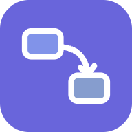
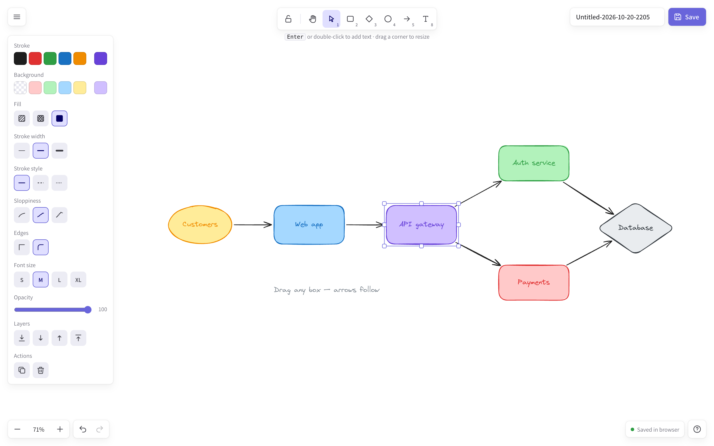
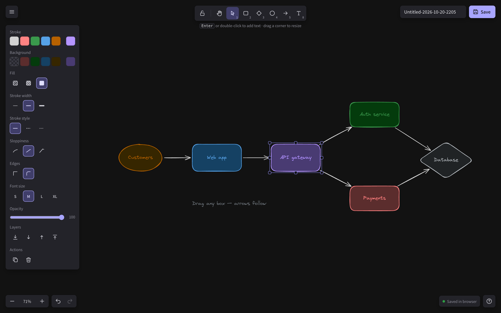

<div align="center">



# Sketchboard

**A free, private, hand-drawn whiteboard for diagrams and ideas.**
No sign-up · Works offline · Installable · Excalidraw-compatible files

[](https://github.com/coderharry1/sketchboard/actions/workflows/ci-cd.yml)
[](https://coderharry1.github.io/sketchboard/)

### ▶ [Open Sketchboard](https://coderharry1.github.io/sketchboard/)

Built by **S. Harish Krishnan** — AI Engineer



</div>

---

## Executive summary

Sketchboard turns a blank browser tab into a whiteboard in under a second. You draw boxes, connect them with arrows that stay attached as you move things, color them, label them, and save. There is no account, no server and no subscription: the whole product is a single 204 KB web page that runs entirely on the user's device.

It was built by **reverse engineering a best-in-class product** ([Excalidraw](https://excalidraw.com)) with the REA reverse-engineering toolkit, identifying what makes it work, and rebuilding the essential experience in a fraction of the size — then hardening it with automated tests and a CI/CD pipeline that deploys every change.

| | |
|---|---|
| **Live product** | https://coderharry1.github.io/sketchboard/ |
| **Cost to use** | Free |
| **Cost to run** | $0 (static hosting on GitHub Pages) |
| **Size** | 204 KB, one file — about 1/11th of the reference app's 2.2 MB main script |
| **Data stored on servers** | None |
| **Quality gate** | 9 end-to-end browser tests on every push |

---

## The problems it solves

| # | Problem | Who feels it | How Sketchboard solves it |
|---|---|---|---|
| 1 | **Sign-up walls.** Most diagram tools want an account before you can draw a single box. | Anyone sketching an idea quickly | Opens instantly. No account, no email, no onboarding. |
| 2 | **Privacy and confidentiality.** System designs, client architectures and internal plans end up on third-party servers. | Engineers, consultants, regulated industries | Nothing leaves the device. Drawings live in the browser and in files the user controls. |
| 3 | **Per-seat cost.** Collaborative whiteboards are priced per user per month. | Students, teachers, small teams, NGOs | Free forever; hosting costs nothing. |
| 4 | **Lock-in.** Work is trapped in proprietary formats. | Teams that switch tools | Saves the open `.excalidraw` JSON format — files open in Excalidraw and vice versa. Copy/paste works between the two. |
| 5 | **Needs internet.** Cloud tools fail on flights, trains and poor connections. | Travellers, field teams, classrooms | Installs as an app and works fully offline. |
| 6 | **Heavy and slow.** Large apps struggle on older laptops and low-end phones. | Users on modest hardware | One small file, no framework, renders on a plain canvas. |
| 7 | **Polished tools kill early ideas.** Pixel-perfect diagrams feel "final" and discourage feedback. | Product, design and architecture discussions | The hand-drawn style signals "draft", inviting discussion. |
| 8 | **Messy diagrams after every change.** Moving a box in a basic drawing tool leaves arrows behind. | Anyone iterating on a diagram | Arrows bind to shapes and re-route automatically when shapes move or resize. |

---

## Why I built it

1. **To learn how world-class products are built, from the outside in.** Using REA, I captured the production web app, mapped its tech stack, rendering pipeline, data model and storage, and turned those findings into an engineering spec.
2. **To show AI-assisted engineering end to end** — reverse engineering, product decisions, implementation, testing, CI/CD and deployment — on a real, usable product rather than a demo.
3. **To make a focused tool that respects the user.** Most people need boxes, arrows, colors and save. Sketchboard does those extremely well, with no tracking, accounts or cost.

---

## Features

**Draw** — rectangles, diamonds, ellipses, arrows and free text · Shift for perfect squares and circles · resize from any handle
**Connect** — drag an arrow from one shape to another; it binds to both and follows them as they move or resize
**Style** — outline color, fill color (5 quick picks + 60-color palette + any hex), fill pattern (hachure / cross-hatch / solid), stroke width, dashed or dotted lines, sloppiness, sharp or round corners, arrowheads, opacity
**Label** — press Enter or double-click a shape to type inside it; text wraps and the shape grows to fit
**Save** — automatic save in the browser · Save / Save as to a `.excalidraw` file · Open or drag-and-drop files · Export PNG
**Work fast** — undo/redo, copy/paste/duplicate, multi-select, layer ordering, arrow-key nudge, zoom and pan, full keyboard shortcuts (press `?`)
**Everywhere** — light and dark mode · responsive on phones and tablets · installable as an app · works offline

<p align="center"></p>

---

## Run it yourself

**Just use it:** open https://coderharry1.github.io/sketchboard/ — or download [`Sketchboard.html`](Sketchboard.html) and double-click it (works offline).

**Develop:**

```bash
git clone https://github.com/coderharry1/sketchboard.git
cd sketchboard
npm install            # test tooling only — the app has no runtime dependencies
npm run serve          # http://localhost:4173
```

| Command | What it does |
|---|---|
| `npm run build` | Rebuild `index.html` and `Sketchboard.html` from `src/index.html` |
| `npm test` | Run the end-to-end test suite |
| `npm run assets` | Regenerate icons, screenshots and the social preview image |

**Project structure**

```
src/index.html          App source (HTML, CSS and JavaScript)
build.py                Inlines rough.js and the Virgil font into one file
index.html              Built app served by GitHub Pages (same as Sketchboard.html)
sw.js                   Service worker for offline use
manifest.webmanifest    Install-as-app metadata
tests/                  Playwright end-to-end tests
scripts/make-assets.mjs Icon, screenshot and social-image generator
.github/workflows/      CI/CD pipeline
```

---

## Roadmap

- Real-time collaboration (peer-to-peer, end-to-end encrypted)
- Curved and elbow arrows; arrow labels
- Freehand pen and images
- Shareable read-only links with the drawing encoded in the URL
- Templates for architecture, flowcharts and mind maps

---

## Credits

Built by **S. Harish Krishnan**, AI Engineer.

Hand-drawn rendering by [rough.js](https://roughjs.com) (MIT). Virgil font by Ellinor Rapp (SIL OFL 1.1). Inspired by [Excalidraw](https://excalidraw.com) (MIT); Sketchboard is an independent project and contains no Excalidraw application code. See [THIRD_PARTY_NOTICES.md](THIRD_PARTY_NOTICES.md).
